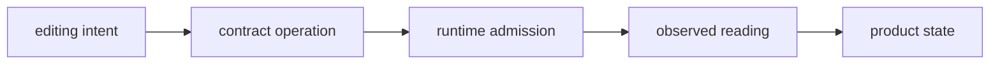

# jedit Data Model

The target runs `Jim.edict` as an Echo-realized active observer: Jedit submits canonical events, Jim-owned Edict lawpacks define operations and optics, and generated clients carry bytes but make no application decisions. This page describes the data that crosses the boundary today and the rules that already hold.

## Doctrine

Jim-owned Edict source owns the **editor contract** and product nouns. Echo owns **generic runtime execution**, admission, scheduler-owned ticks, receipts, readings, and retained evidence. Edict compiles Jim-owned application law into verified generic packages plus semantic-free codecs and transport stubs.

The rope model is jedit contract law hosted through Echo's generic graph and contract-host surfaces. Echo must not implement a privileged jedit rope engine.

Contract flow:

Core rules:

- Every durable or recoverable user-state transition, and every authoritative reading used to reconstruct that state, must pass through Echo-owned admission, scheduling, witnessed history, receipts, and recovery. Jim may own domain semantics and disposable projections; it may not substitute a local map, cache, fixture, or handwritten host for Echo authority.
- App-facing jedit code carries opaque Jim-owned rope-head identities and branded UTF-8 byte ranges when it requests materialized text. It does not derive, inspect, or mint those identities.
- A buffer reopened for a file is reused only when its anchored import names the file's current bytes; see [Workspace buffer durability](#workspace-buffer-durability).
- Echo hosts generic installed contracts, schedules admitted work, and produces evidence.

## Current boundary

- **Workspace session**: `ProductionTextSession` (`src/app/workspace/production-text-session.ts`) is the only path from the workspace to text authority. Its production adapter is `src/adapters/workspace-production-text-session.ts`.
- **Host port**: `EchoTextContractHostPort` (`src/ports/echo-text-contract-host.ts`), implemented by a child process (`src/adapters/echo-text-contract-host-process.ts`) that speaks newline-delimited JSON to the native host.
- **Native host**: `native/jedit-echo-host` admits the generated operations of `contracts/jedit/echo-text.graphql` (generated with `echo-wesley-gen --contract-host`) into Echo, persists through Echo's runtime WAL, and recovers from it on restart.
- **Materialization basis**: an opaque Jim `basisHeadId` plus a branded UTF-8 range.
- **Runtime coordinate**: the Echo worldline stays inside the native host.

If app-facing code unwraps a branded offset outside a serialization or external adapter boundary, or derives an authority identity, the boundary is wrong.

***

## Readings and durability

### Authoritative line summaries and disposable indexes

Line metrics retained by `RopeHead`, `RopeBranch`, and `RopeLeaf` are
authoritative Jim facts. They participate in rope validation, causal readings,
and retained evidence. A line-offset index is different: it is a versioned,
basis-pinned projection derived from complete UTF-8 coverage of one rope head.

The current disposable projection records:

- the worldline and rope head that supplied its basis;
- the immutable head metrics used to validate that basis;
- the complete branded UTF-8 byte range it indexed;
- zero-based line identities and branded byte offsets for line content and the
  following line start; and
- a projection kind and implementation version.

The store keys indexes by both worldline and head identity. Head labels are not
assumed globally unique. An observer may reuse a matching index to select a
bounded text window, but it must reject and evict the index when the requested
coverage or returned head metadata no longer matches.

Line projection treats CRLF as one logical break and preserves the original
UTF-8 byte width of Unicode text. Clearing every line index changes only read
cost: the same index can be rebuilt from the same basis. It cannot change rope
history, retained rewrite evidence, `:why` answers, or the authoritative line
counts. The projection must never be emitted as a graph fact or used to mint a
head, receipt, or causal identity.

### Disposable text-window materializations

A text-window materialization is a derived read artifact, not rope authority.
Its cache key records:

- the Jim worldline and opaque rope head used as its basis;
- the exact branded UTF-8 byte coverage;
- the schema and materializer versions;
- the observer plan and policy digest; and
- a request-frontier namespace used to prevent reuse across distinct requests.

`requestFrontierRef` is intentionally not called an Echo frontier. The current
value is supplied by the transitional request corridor and is not evidence of
an Echo-admitted causal frontier. Likewise, `coordinateDigest`,
`cacheKeyDigest`, and `policyDigest` are Jim-local acceleration identifiers.
They must not be accepted as Echo facts, receipts, anchor identities, WAL
evidence, or provenance.

Completeness means that the cached projection exactly covers the byte range in
its key. It does not mean that the range covers the whole document. A stale
schema, materializer, policy, basis, coverage, or projection mismatch makes the
entry unusable. The observer evicts or ignores that entry and rematerializes
from the requested rope basis; it never silently serves the stale bytes.

The cache reports `materializedProjectionBytes` separately from graph-rope
retention metrics. Clearing or evicting every materialization may make reads
slower, but it cannot change a rope head, graph fact, rewrite, receipt,
checkpoint, `:why` result, or recovery outcome. A future native Echo/Edict read
corridor may replace the request namespace with opaque admitted basis evidence,
but Jim must consume that evidence rather than derive or mint it.

### Workspace buffer durability

Workspace durability is not one scalar and it is not a synonym for `dirty`.
`WorkspaceBufferDurability` keeps five propositions independent:

- whether a Jim intent is still pending and has not advanced causal text;
- which opaque rope head Echo has admitted for the buffer;
- which rope head supplied the last successfully written file projection;
- whether an external Git observer has found that projection in a local commit;
  and
- whether an external Git observer has found that commit on a named remote.

The default Git posture is `unknown`. Jim must not infer Git durability from
worldline names, causal ahead/behind counters, filesystem materialization, or a
rope checkpoint. An explicit Git adapter may replace the unknown readings with
observed commit evidence later.

A checkpoint declaration and a saved file are also separate propositions.
Declaring a checkpoint records its checkpoint and basis-head identities. It is
associated with the saved-file layer only when the saved projection names the
same head. A save/export result moves the file layer only after the host write
succeeds and carries its own basis head, reading identity, and fingerprint.
Neither operation advances causal text.

`workspaceBufferFileDirtyReading` derives file dirtiness from those independent
facts. It reports `clean` when the current admitted head equals the file or
host-absence basis, and `dirty` when both bases are known but differ. If either
basis is unavailable, the reading is explicitly `unavailable`; callers must not
invent an Echo identity or treat a pending intent as an admitted head merely to
obtain a boolean.

The worldline drawer uses the pending-intent proposition, not file dirtiness, to
decide whether to render a local optimistic rail. Consequently, an admitted but
unsaved head is dirty without being mislabeled as unconfirmed local work, while
an obstructed intent remains visible as a conflicted optimistic projection.

The footer renders the same propositions as separate labels: `intent:*`,
`causal:*`, `file:*`, `git:*`, and `remote:*`. `causal:unsaved` is emitted only
when an admitted current head and file basis are both known and differ;
`file:exported` requires a successful export reading. Git and remote labels use
only explicit observer evidence and default to `unknown`. Opaque head, receipt,
reading, and commit identities are not shortened, compared, or reconstructed by
the formatter. Cursor `line:col` stays on the mode row because it is UI state,
not durability evidence.

This means queuing or obstructing an edit cannot make an otherwise clean file
authoritatively dirty. An optimistic editor projection may still be marked dirty
for immediate interaction, but it is not causal authority. Once Echo admits a
new head, that head differs from the saved-file basis and the authoritative
reading becomes dirty. Declaring a checkpoint does not clear it. A successful
host export clears it only by recording the exported head as the new file basis.
The comparison does not consult Git.

On open, the file and host-absence bases come from the buffer's anchored import, never from the head the buffer has reached, so a reused buffer is clean only at its anchored head and a buffer without an anchor has an `unknown` file layer rather than one assumed to match. A missing-file open uses the anchored head as its `hostAbsenceBasisHeadId`, so a newly opened, not-yet-materialized buffer begins clean without using the legacy `dirty` field as causal evidence. When a buffer may be reused at all is owned by [How Jim sees source files](jim-component-ownership.md#how-jim-sees-source-files).

The legacy `dirty` and `materialization` fields remain compatibility
projections during CR-04. New durability behavior must read the structured
model. The following slices derive footer language and change counts from its
opaque causal and file bases before those legacy fields are removed.

***
## Rope posture and operating rule

The rope, piece table, or any other text data structure is part of the jedit
contract and generated host model, not Echo core. The app-facing contract says:

> replace byte range with text
> read bounded text window
> preserve deterministic history
> produce evidence-bearing readings

jedit may model this as rope-shaped Echo graph facts, a piece table, a
persistent tree, a chunk graph, or another generated contract representation
that satisfies the law. Echo should see generic installed contract work and
retained evidence, not a built-in text data structure. Event-sourcing and
projection-oriented systems routinely separate write-side history from
read-side projections, which matches the split between admitted runtime
operations and observed text windows here.

**Operating rule:**

If a jedit layer needs forbidden runtime knowledge such as worldlines,
scheduler state, rope nodes, or the representation of a head identity to make
progress, the boundary is wrong or the witness is not ready.
