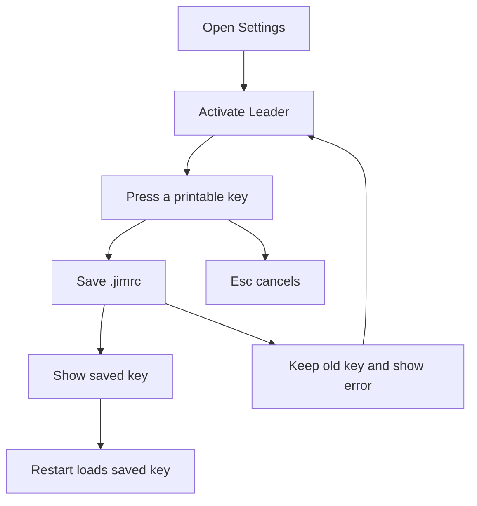
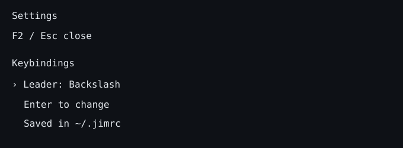
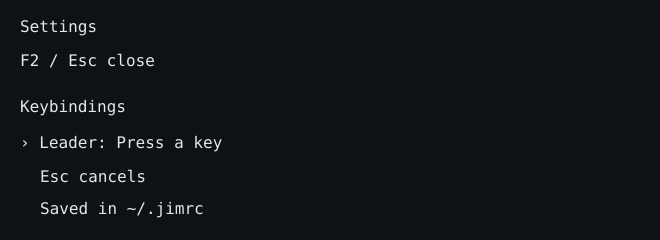

# DX-0159 - Configure the Leader key

## Linked Issue

- https://github.com/flyingrobots/jedit/issues/335

## Decision Summary

Add a Keybindings section with a Leader row to Settings. Activate the row,
press one printable key, and persist it in a data-only JSON `~/.jimrc`.
Backslash is the default. This cycle configures the prefix; it does not add
leader command mappings or an executable configuration language.

## Sponsored Human

A keyboard user wants to choose Space or another Leader key and retain that
choice when restarting Jim.

## Sponsored Agent

An agent needs an inspectable configuration schema and settings state rather
than inferring the prefix from a rendered label.

## Hill

A user can select Leader in Settings, capture a key, cancel or recover from
failure, and restart with the saved preference. Runtime and filesystem specs
exercise that journey.

## Current Truth

Settings currently expose session-only appearance, editor, and locale choices.
There is no configuration-file adapter or Leader preference.
See [settings-session.ts#225:ecefbbb695ddeedaed94e0046c580e2041cca40f](https://github.com/flyingrobots/jedit/blob/ecefbbb695ddeedaed94e0046c580e2041cca40f/src/app/settings-session.ts#L225)
and [workspace-app.ts#64:ecefbbb695ddeedaed94e0046c580e2041cca40f](https://github.com/flyingrobots/jedit/blob/ecefbbb695ddeedaed94e0046c580e2041cca40f/src/adapters/workspace-app.ts#L64).

## Problem

Users cannot configure a Leader prefix. A session-only choice would disappear
on restart.

## Scope

- Keybindings section and single-key Leader capture.
- Global `~/.jimrc` load and atomic save through an injected settings port.
- Validation, visible errors, cancellation, and restart tests.

## Non-Goals

- Leader sequences, explorer mappings, general key remapping, project-local
  configuration, executable Vimscript, or persistence of other settings.
- Buffer mutations or changes to the Echo text authority corridor.

## User Experience / Product Shape

Reuse the existing Settings drawer and its focus/navigation/rendering.
Leader displays Backslash, Space, or the chosen character. Enter, Space, or
Left/Right activation starts capture. Capture displays a persistent prompt.
The next unmodified printable character commits. Canonical `space` normalizes
to a literal space. Esc cancels without closing Settings. F2 cancels and
closes Settings. Other special keys and modified keys leave capture active
with a readable validation message. Ctrl+C retains shell quit behavior.

Saving succeeds before the active preference changes. The row remains focused
and the existing settings toast confirms the change. A save error leaves the
old value active, shows the error in the row, and permits another attempt.
Malformed startup configuration falls back to backslash with a durable row
error; Jim never silently overwrites malformed configuration.

### User Journey



### Wide UI Mockup

Existing drawer at 100 by 32, built-in dark theme. The new section uses the
same heading, row, and description treatment as existing settings.



### Narrow UI Mockup

Existing drawer at 60 by 16. Selection scrolling keeps the Leader row visible;
labels and help use the existing clipping behavior.



### Accessibility Considerations

Keyboard-only operation; textual value, capture prompt, and errors. No color
alone encodes success or failure. Pointer/touch settings editing remains
outside the existing drawer contract.

## Runtime / API Contract

A `LeaderKey` validated value owns a single printable Unicode scalar.
`JimSettingsPort.load()` returns the preference and an optional issue;
`saveLeader()` returns an optional error. Filesystem and JSON handling stay
in the adapter. The workspace owns capture state and uses the injected port.
No filesystem dependency enters the application core.

## Lower Modes

Plain-text rendering remains usable without color. The workspace retains its
minimum of 60 columns by 12 rows; smaller terminals show the existing size
message. Missing `.jimrc` uses the default without creating a file. Hosts without a persistence adapter show a
save error instead of claiming durability. Settings need no Echo text read or
mutation for this preference.

## Data / State Model

| Category | Description |
| --- | --- |
| Source of truth | Saved `keybindings.leader` in `~/.jimrc`; active session preference after successful load/save. |
| Derived state | Display name and capture prompt. |
| Invalid states | Empty, multiple characters, controls, lone surrogates, special-key names. |
| Reset behavior | Capture cancellation preserves the active key. Backslash can be recaptured to restore default. |
| Serialization | JSON object, e.g. `{"keybindings":{"leader":" "}}`. |
| Preservation | Unrelated root and keybindings fields survive saves; malformed existing files remain untouched. |

Atomic replacement prevents partially written configuration. Saving rereads
the file to preserve unrelated edits made since startup. Symlinked dotfiles
retain their link and update the target. Live reload and multi-process write
arbitration are not part of this cycle.

## Accessibility Posture

| Concern | Posture |
| --- | --- |
| Labels | Leader row with stable `leader` id. |
| Focus | Remains on the row after capture, cancellation, and failure. |
| Keyboard | Capture owns printable input; Esc cancels; Ctrl+C quits. |
| Secret handling | Configuration contains preferences only. |

## Localization / Directionality Posture

New section, labels, values, prompts, and errors use catalog keys. Update every
authored locale and regenerate the mirror locale. Existing drawer placement
and directionality are preserved. Validate with `node scripts/gen-i18n.mjs`
and rendered LTR/RTL settings specs.

## Agent Inspectability / Explainability Posture

Inspect `leaderKey`, capture state, row id `leader`, and the JSON file. Tests
exercise the public runtime and settings renderer rather than private text.

## Linked Invariants

- Tests are executable spec; validation and decoding belong at the boundary.
- Settings preference writes never mutate buffers or manufacture Echo evidence.
- Preserve unrelated configuration and user-owned checkout state.

## Design Alternatives Considered

### Cycle through a fixed list

Simpler interaction but cannot express the user's own printable key.

### Execute `.jimrc` as a script

Adds an execution language for one preference. Data-only JSON meets this task.

## Decision

Capture one printable key and persist only that preference in global JSON.
Use the existing Settings grammar with a capture state rather than adding a
new modal or layout.

## Implementation Slices

- [x] Slice 1: Validated Leader preference and field-preserving `.jimrc` adapter.
- [x] Slice 2: Settings capture, production wiring, and localized feedback.
- [x] Slice 3: Runtime/render/restart witness, docs, and required validation.

## Tests To Write First

- [x] Settings render exposes the current preference and capture state.
- [x] Runtime captures Space and custom keys; Esc/F2 cancel; invalid input stays in capture.
- [x] Save/restart retains the key and preserves unrelated JSON fields.
- [x] Malformed config and write failure retain previous data and visible errors.

## Acceptance Criteria

- [x] User can configure the Leader key through Settings and restart with it.
- [x] Configuration is optional, data-only, validated, and safely replaced.
- [x] Rendered output and failure/cancellation paths have executable evidence.
- [x] Catalogs, docs, issue, and PR reflect the scope.
- [x] Required local checks pass; CI state is disclosed independently.

## Validation Plan

```bash
npm run check
```

## Playback / Witness

Open Settings with F2, navigate to Keybindings → Leader, press Enter, then
Space. Close and restart Jim. Reopen Settings and verify Space. Repeat with
Esc during capture and with a malformed `.jimrc` in an isolated home directory.
Runtime specs reproduce this without writing the real user's home directory.

## Risks

Filesystem errors and malformed manual edits must remain visible. Do not
overwrite bad files or report a value as saved before persistence succeeds.
Existing hard-global key precedence must not steal printable capture input.

## Follow-On Debt

Leader command mappings remain separate from this preference-only cycle:
[issue #337](https://github.com/flyingrobots/jedit/issues/337) owns the requested
explorer toggle. No new mapping behavior is promised by this design.

## Retrospective

The implementation follows the capture and data-only configuration design.
Symlink preservation was added after a failing filesystem witness showed that
ordinary atomic replacement would replace the link itself. Small-terminal
inspection confirmed the existing 60-column minimum, so the narrow mockup
assumption was corrected from 40 to 60 columns. Capture-specific drawer and
footer hints replace ordinary navigation hints while capture owns input.

Ten specs in `spec/leader-settings.spec.mjs` prove validation, default loading,
capture/cancellation, special/modified-key rejection, save/restart through the
production app composition, unrelated-field preservation, symlink preservation,
malformed-file refusal, failed-write recovery, and persistent row errors.
The filesystem cases use temporary homes. The text dependency in the automated
composition case is an explicitly injected test double; no buffer edits occur.

`npm run check` passed: 881 JavaScript tests passed, 12 skipped, 99 native Rust
tests passed, and the quality gate reported no regressions. The existing
tracked test-file size debt remains unchanged. Published implementation commit
`646d399a` also passed all twelve GitHub Actions checks, including the real Echo
release-gate witness. After adding the locale-rendering witness, all ten focused
specs and the quality gate also passed.

A live PTY run used the production app and real native Echo host with an
injected temporary configuration directory and isolated WAL. At 100 by 32,
F2 → eight Down presses → Enter → Space saved the key and displayed its toast.
Enter → Esc canceled a second capture without changing the saved Space.
Restart at 60 by 16 loaded Space; the Leader row and capture-specific hints
remained visible. Ctrl+C restored the terminal and closed the host. Rendered
cell snapshots were visually inspected. Below 60 columns the existing minimum
size message appeared.

New copy was authored for every supported locale and the mirror catalog was
regenerated. Automated localized rendering covers LTR and RTL catalogs; native
PTY dogfooding used English. Translation quality has not had native-speaker
review. Preference persistence is scoped to Leader; general settings
persistence, live config reload, and concurrent-process write arbitration are
not implemented. Leader sequence dispatch is tracked in #337.

PR: https://github.com/flyingrobots/jedit/pull/336
