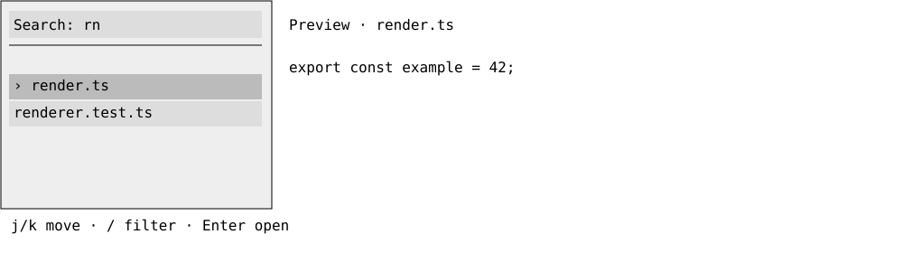
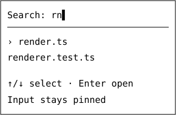

# DX-0161 - Sticky explorer search

## Linked Issue

- https://github.com/flyingrobots/jedit/issues/340

## Decision Summary

Give the Files drawer a sticky, focused search field and live fuzzy filtering
of the directory entries already loaded by the workspace. The query is a
session-only UI projection; there is no persistent index, SQLite, recursive
scan, semantic retrieval, or symbol extraction in this cycle.

## Sponsored Human

A keyboard user opens Files and wants to immediately type a partial file name
or relative path, see matching entries, and open one without switching modes.

## Sponsored Agent

An agent needs inspectable query/cursor state and one shared filtered-entry
projection for painting, navigation, opening, and pointer hit-testing.

## Hill

Ctrl+B opens the drawer with a visible caret in its pinned input. Typing updates
the displayed results immediately. Arrows select a visible match and Enter
opens exactly that match through the existing file-open path.

## Current Truth

The Files drawer renders only a scrollable list. Its focused keys perform
navigation and directory actions; there is no input or query state. See
[viewer-drawers.ts#14:5d7b0957a2511ac28b9ec9f47c9e6c432f89deea](https://github.com/flyingrobots/jedit/blob/5d7b0957a2511ac28b9ec9f47c9e6c432f89deea/src/app/workspace/viewer-drawers.ts#L14)
and [file-tree.ts#47:5d7b0957a2511ac28b9ec9f47c9e6c432f89deea](https://github.com/flyingrobots/jedit/blob/5d7b0957a2511ac28b9ec9f47c9e6c432f89deea/src/app/workspace/file-tree.ts#L47).

Graft exposes per-file outline projections through `GraftSessionPort`, not a
ready-made workspace-wide symbol inventory. This PR is stacked on #339.

## Problem

Opening the explorer does not provide a place to type. Printable keys currently
perform actions such as navigation, refresh, quit, or perf toggling.

## Scope

- Pinned single-line input, automatic focus, visible caret, horizontal query scrolling.
- Case-insensitive ordered-subsequence matching of loaded names and relative paths.
- Shared filtered-entry identity for render, keys, wheel, click, and file opening.
- Query editing, empty results, directory transition, and focus/close behavior.

## Non-Goals

- Recursive workspace inventory, semantic retrieval, Graft symbol scan, SQLite, persistence.
- Leader configuration/dispatch or changes to authoritative Jim/Echo text state.

## User Experience / Product Shape

The refinement replaces automatic input editing with explicit explorer modality.
Ctrl+B opens Files in navigation mode. j/k and Up/Down select results; `/` enters
filter editing. Clicking the input also enters editing. Esc or Enter in editing
returns to navigation while preserving the query. Esc in navigation closes the
drawer. Ctrl+B closes from either mode. Reopening starts in navigation with the
session query retained. F2 and Tab leave filter editing before changing focus.

The search field remains pinned and uses a distinct theme background. Its caret
is visible only while editing and Files owns focus. Query edits select the first
match. Matched filename characters retain the accent and bold styling. Directory
changes clear the query. j/k/r/Backspace/h/l regain list actions in navigation;
Ctrl+R refreshes and Alt+Up goes to the parent in either mode.

Pointer motion highlights the row under the cursor without changing selection
or loading a preview. Hover and selection have distinct theme backgrounds;
selection takes precedence if the cursor is over the selected row. Clicking a
row selects it and returns to navigation. A file selection previews it in the
main viewer while focus remains on Files. Clicking a directory only selects it;
Enter enters it. Enter on a file opens it through the native Echo path and moves
focus to the editor. Closing or leaving Files restores the existing editor.

Preview is an explicitly labelled, read-only, bounded projection. The current
active buffer and other open buffer projections are preferred so unsaved text is
visible. Otherwise a filesystem adapter reads at most 64 KiB and 200 lines.
Binary, directory, unavailable, loading, and truncated previews are labelled.
Preview does not create an Echo buffer, change text authority, edit, or save.
Request identity and selected source entry reject late results. Selecting a
new item replaces the previous preview with loading immediately; no matches or
non-file selection clears it. No persistent preview cache is introduced.

Terminal input must deliver Unicode scalars and modified arrows through a
Jedit boundary adapter; all-motion mouse reporting enables hover. Windows path
normalization occurs at the filesystem boundary with a portable search-path
field, leaving native paths intact for opening. Existing review findings on
these boundaries are included in this refinement.

### User Journey

Open Files → select with j/k or pointer → inspect preview → Enter opens.
Press / → type query → Esc → choose a filtered result. Backspace
or Ctrl+U restores broader results; Esc closes and returns to the normal pane.

### Wide UI Mockup

100×32 workspace, existing drawer/theme. The input row and separator stay pinned.



### Narrow UI Mockup

60×16 workspace. The query scrolls horizontally; the selected row remains visible.



### Accessibility Considerations

Text label, visible caret, visible selected result, and an explicit no-match
message. Keyboard-only editing and opening; focus is never inferred from color
alone. Pointer mapping uses the same geometry as rendering. Existing minimum
terminal geometry remains unchanged.

## Runtime / API Contract

`WorkspaceModel.fileSearch` holds input and cursor coordinates. A pure selector
returns visible entries with their source indexes; `selectedIndex` retains the
loaded-entry index so existing file-opening identity is preserved. Query changes
select the first match or no selection. All filtered actions use that selector.
The input handler runs before plain global shortcuts when Files owns focus;
Ctrl+C, close, pane switching, and Settings retain their existing routes.

## Lower Modes

Input, query, selected rows, and no-match text remain visible without color.
The caret uses the existing theme token. Small viewports clip safely. No Graft
or optional database adapter is required; unreadable directory errors retain
existing file-system feedback and preserve the prior query/list.

## Data / State Model

| Category | Description |
| --- | --- |
| Source of truth | Existing loaded FileEntry list and session query/caret. |
| Derived state | Filtered entries, selection position, text window, list scroll offset. |
| Invalid states | Controls in query; opening an entry excluded by the current query. |
| Reset behavior | Successful directory change clears query; closing preserves it. |
| Persistence | None. A restart begins with an empty query. |
| Causal boundary | Disposable presentation over loaded file-system entries; no authoritative index or text mutation. |

## Accessibility Posture

Input focus stays on Files during arrow selection. Opening a file returns focus
to the existing editor/open path. Closing uses the existing pane restoration.
Empty results are readable rather than silent. Search is scoped to the loaded
directory, so it does not claim a complete workspace inventory.

## Localization / Directionality Posture

New search label, placeholder, empty-results text, and footer hints use catalog
keys for every authored locale and the generated mirror locale. File paths keep
their literal order; existing drawer directionality remains. Width calculations
use terminal display-cell lengths, and Unicode input boundaries are preserved.

## Agent Inspectability / Explainability Posture

Inspect query/caret, selected source index, and the visible-entry selector.
Runtime tests assert the requested path rather than a fabricated open result.
Render tests inspect fixed row positions and cursor tokens. Live PTY exercises
real input decoding and the native-host file-open route.

## Linked Invariants

- Source lists and buffers are not optimistically mutated by filtering.
- Derived UI indexes do not become causal or filesystem authority.
- One list projection and geometry serve all result interactions.
- Tests prove real runtime behavior and rendering.

## Design Alternatives Considered

An input-only field would not help locate files. A small deterministic fuzzy
filter requires no index or additional service. A repository crawler or symbol
scan needs bounded asynchronous inventory and stale-result rules, so it is
tracked separately in #341. SQLite has no demonstrated need in this slice.

## Decision

Ship the pinned input and ephemeral fuzzy filtering over loaded entries. Keep
workspace-wide and symbol search separate.

## Implementation Slices

- [x] Slice 1: Input state, fuzzy projection, and keyboard/open behavior.
- [x] Slice 2: Sticky input/caret rendering, pointer/wheel mapping, and localized help.
- [x] Slice 3: Runtime/render/native-host verification and documentation.
- [ ] Slice 4: Explicit navigation/filter modes and mode-aware help.
- [ ] Slice 5: Pointer hover, click selection, and distinct row colors.
- [ ] Slice 6: Bounded read-only viewer previews and stale-result rejection.
- [ ] Slice 7: Real input boundary fixes, native verification, and refined docs.

## Tests To Write First

- [x] Ctrl+B focuses a visible input; printable shortcut keys type query text.
- [x] Fuzzy matching, no matches, editing, and Unicode caret movement behave correctly.
- [x] Arrows/Enter/click open the displayed match rather than a hidden source entry.
- [x] Header stays pinned while results scroll; mouse/wheel use the filtered list.
- [x] Close/reopen, Settings, pane switching, refresh, and directory transitions preserve the contract.

## Acceptance Criteria

- [x] Input is pinned, focused, and visibly editable on open.
- [x] Loaded paths filter live with no persistent cache or index.
- [x] All result interactions share the same projection and geometry.
- [x] Empty results cannot open a hidden file.
- [x] Full repository checks, localized rendering, and live PTY validation pass.

## Validation Plan

```bash
npm run check
npm run ci:verify-shards
```

## Playback / Witness

Ctrl+B → type partial name → Down → Enter. Repeat with no matches, clear with
Ctrl+U, edit in the middle, scroll a long list, and click a filtered row. Inspect
at 100×32 and 60×16, including the real native-host file-open path.

## Risks

Existing j/k/r/Backspace navigation is intentionally replaced while input owns
focus; footer help must match. Filtering changes displayed indexes, so stale
raw-index pointer calculations can open the wrong file. Unknown-symbol and
workspace-inventory claims must remain outside this feature.

## Follow-On Debt

[Issue #341](https://github.com/flyingrobots/jedit/issues/341) owns evaluation of
workspace-wide file, semantic, and Graft symbol search with disposable indexes.

## Retrospective

Implemented with one shared filtered projection retaining original entry indexes.
The input owns printable keys while focus remains on Files; pointer geometry
reserves the same pinned rows as painting. Match highlights use the filter's
Unicode character positions, preferring filename matches when possible.

The initial red tests exposed the missing input state and later the missing
visual distinction. Existing list-navigation and pointer tests were updated for
arrow navigation and the two extra pinned rows. Thirteen focused runtime/render
tests pass, including Japanese, Arabic, and mirrored labels, wide-character
caret mapping, and distinct input backgrounds across 16 built-in theme variants.
The full repository check passes, and shard coverage includes all 131 specs.

Live native-host PTY sessions at 100×32 and 60×16 confirmed decoded input,
focused query editing, no-match Enter safety, and the selected fixture's actual
Echo import result with its expected source content. Terminal snapshots were
inspected at both sizes; the input remained at the top and matched characters
were accented. Quality reports no regressions and its debt baseline is unchanged.

No persistent query, recursive inventory, symbols, semantic retrieval, or cache
was added. These remain explicit follow-on work in #341. This change is stacked
on the static-title removal in #339; neither PR is merged by this cycle.

### Refinement acceptance (2026-10-14)

- [ ] j/k navigates after opening; slash/click edits; Esc returns to navigation.
- [ ] Hover never selects or reads a file; click selects; colors remain distinct.
- [ ] Selected files preview without changing buffers, dirty text, or authority.
- [ ] Bounded, unavailable, binary, stale-result, and focus-return cases pass.
- [ ] Actual terminal Unicode, modified arrows, and hover packets are exercised.
- [ ] Full local checks and CI pass; documentation reflects final behavior.

Refinement retrospective: pending implementation.
