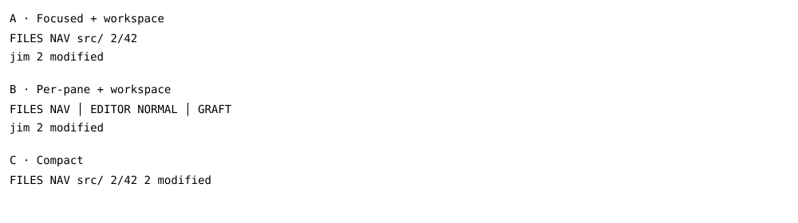
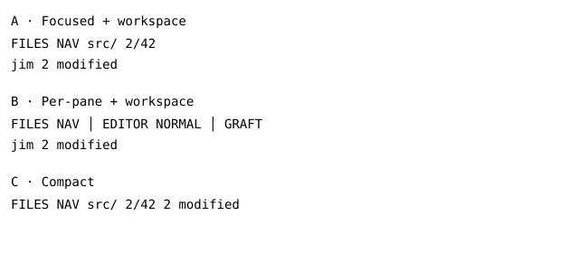

# DX-0162 - Selectable footer layouts

## Linked Issue

https://github.com/flyingrobots/jedit/issues/343

## Decision Summary

Settings → Appearance → Footer layout selects Focused + workspace (A, default),
Per-pane + workspace (B), or Compact (C). One shared observation supplies all
layouts. The existing footer visibility toggle remains independent.

## Sponsored Human

An editor user chooses the balance of focused-surface information, workspace
awareness, and available content rows without losing modal input ownership.

## Sponsored Agent

An agent inspects the selected layout, surface descriptors, and observed global
counts without parsing painted terminal text or inferring service health.

## Hill

Choose any layout in Settings and see its real arrangement immediately. Files
and Graft retain their own facts; an inactive editor cannot donate its cursor
position to a focused drawer. Compact returns one row to workspace content.

## Current Truth

At 44d28cb96458254076d9c181e16e38da927cfd01, the footer has two fixed rows,
mode/position/help above path and optional raw buffer posture. The current
Appearance settings are session-only. Settings uses directional choice rows.

[settings-session.ts#229:44d28cb96458254076d9c181e16e38da927cfd01](https://github.com/flyingrobots/jedit/blob/44d28cb96458254076d9c181e16e38da927cfd01/src/app/settings-session.ts#L229)

The branch stacks on #342, preserving its Files modal navigation and previews.

## Problem

One fixed layout forces a density preference and mixes unrelated surface facts.
Static two-row geometry also prevents a true compact one-row option.

## Scope

Three selectable arrangements; immediate settings feedback; focus-correct local
facts; observed workspace buffer/modified/pending counts; shared row geometry;
keyboard/mouse/completion alignment; authored localization; actual TUI witnesses.

## Non-Goals

New Git/branch watchers, diagnostics aggregation, fabricated health summaries,
configurable widget plug-ins, arbitrary editor splits, or semantic editor changes.

## User Experience / Product Shape

F2 opens Settings. Appearance contains separate Show footer and Footer layout
rows. Left/Right cycle backward/forward; Enter and Space advance. Switching is
immediate and preserves the selected Settings row, buffers, input, and drawer
selection. Closing Settings keeps the selected layout. A remains the default.

A uses the first row for focused surface/mode, identity and relevant details;
the second row is global workspace information. B divides the first row into
segments aligned under the visible Files, viewer and Graft panes, styling the
focused segment more strongly, and shares the second global row. Settings and
startup overlays describe their own focused surface. C combines the focused
surface and compact global counts on one row. Content height and pointer hit
geometry consume that same row count.

Labels identify observed facts. File paths shorten before mode/modified flags
or useful position/rank information. Global facts describe known workspace
buffers; they do not claim a healthy backend, clean Git tree, or durable edits.
Unknown source state cannot become a success label. Command input temporarily
owns the local row while global counts stay visible, including in Compact.
Command completion remains anchored above the real input row.

### User Journey

F2 → Appearance → Footer layout → Left/Right → inspect immediate result → Esc.
Then open Files, filter, preview and open a file in the chosen arrangement.

### Wide UI Mockup

100-column terminal, existing theme and monospace font:

### Narrow UI Mockup

60-column terminal. Identity clips before owner/mode and reserved global count.

### Accessibility Considerations

Text names accompany selection and modes; theme tokens distinguish focus. The
setting works by keyboard. Existing minimum terminal dimensions remain valid.

## Runtime / API Contract

A FooterLayout runtime value names the three choices and one shared row-count
function supplies rendering, viewport, pointer and completion geometry.
WorkspaceModel.footerLayout is presentation state, initially loaded through an
injected preferences port from ~/.jimrc. The new choice row
uses the existing settings activation/delta and feedback route. Footer
observations separately describe focused and visible surfaces plus global counts.
Layouts format these observations without collecting new authority.

## Lower Modes

A and B reserve two rows; C reserves one; hidden footer reserves zero. Very
small terminal notices retain their current priority. Plain terminal cells and
translated text remain usable without custom fonts, graphics or animation.

## Data / State Model

| Category | Description |
| --- | --- |
| Source of truth | Existing workspace model and selected presentation layout. |
| Derived state | Surface identity/mode/rank, observed buffer counts, rows and paint geometry. |
| Invalid states | Unrecognized layout value; editor position assigned to an unrelated drawer. |
| Reset behavior | Reload the remembered layout; missing or invalid preferences use Focused + workspace. |
| Persistence | User accepted remember-across-launches. Save footerLayout in ~/.jimrc as JSON; preserve unrelated fields and refuse malformed documents. |
| Causal boundary | Presentation only; preferences file write through a Jedit adapter, without new Echo Tick, buffer, or index. |

## Accessibility Posture

Owner/mode remain readable, input focus is explicit, errors retain their current
feedback routes, and changing layout does not steal focus or clear user input.

## Localization / Directionality Posture

Choice labels/descriptions and new visible status phrases use all authored
locales and generated mirror output. Width uses display cells. Right-to-left
content respects logical priority and does not reverse literal paths.

## Agent Inspectability / Explainability Posture

Inspect footerLayout, shared row count, surface descriptors and global counts.
Tests assert rendered cells, real Settings changes and pointer/open behavior.
Native PTY witnesses validate all three arrangements at wide and narrow sizes.

## Linked Invariants

- One set of observed facts serves all arrangements.
- Footer visibility and layout are independent.
- Rendering and hit-testing share row geometry.
- Buffers, query text, selected results and authoritative text are unchanged.

## Design Alternatives Considered

Choosing only A would discard the user's explicit preference for choice. Making
B and C mere text variations would not provide per-pane ownership or save space.
Three separate status implementations would allow facts and behavior to diverge.

## Decision

Provide one setting with three real arrangements over shared observations.
Reuse existing theme and settings interactions. Add no new unobserved data.
The user explicitly chose persistence across launches. Update the layout only
after a successful save; otherwise show an error and retain the prior choice.
Write a same-directory temporary file and rename, preserve permissions and
symlink targets, and edit only the owned JSON value span. This preserves
unrelated settings and large numeric values without reserializing them.

## Implementation Slices

- [x] Slice 1: Layout runtime choice and Appearance setting.
- [x] Slice 2: Shared focus/global facts and three rendered arrangements.
- [x] Slice 3: Dynamic viewport, pointer and command-completion geometry.
- [x] Slice 4: Full checks, real terminal verification and documentation.

## Tests To Write First

Preferences tests first demonstrated missing-adapter failures, then cover restart,
raw JSON preservation, malformed/duplicate refusal, file mode and symlinks.

- [x] Settings cycles A/B/C both ways and preserves the selected control.
- [x] A/B reserve two rows, C one, and hidden footer zero.
- [x] B segments follow actual pane boundaries and active focus.
- [x] Files filter/nav facts never reuse editor coordinates.
- [x] Compact preserves global counts during command input.
- [x] Pointer clicks and completion anchors agree with changed body height.
- [x] Narrow/RTL render and layout switching preserve state.

## Acceptance Criteria

- [x] All three choices have distinct correct rendering in the actual workspace.
- [x] Immediate choice feedback and footer visibility work through Settings.
- [x] Global counts come from current model observations only.
- [x] Geometry and input ownership remain correct in all layouts.
- [x] Localization, local checks, native witnesses and CI pass.

## Validation Plan

npm run check; npm run ci:verify-shards; wide/narrow native PTY interactions.

## Playback / Witness

Choose each layout via F2, close Settings, Ctrl+B, j/k, / filter, Escape, pointer
hover/click, Enter. Type :edit and inspect its input/completion anchor. Repeat at
100×32 and 60×16 and with mirrored localization.

## Risks

A row-count change can desynchronize pointer and source viewport geometry.
B's narrow segments must prioritize owner/mode over long paths. Existing UI
helpers have size caps; extension must preserve the quality ratchet.

## Follow-On Debt

Other settings retain their existing lifetimes. Git/service
widgets require actual observation providers before they can be displayed.

## Retrospective

The setting and all three arrangements are implemented over shared surface and
global observations. The default is Focused + workspace. The user chose durable
preferences; `~/.jimrc` saves only `footerLayout` and leaves unrelated bytes,
permissions and symlink targets intact. Failed writes retain the old model and
produce an error toast. No text/history authority moved into the preferences file.

The final full local check passed 882 tests with 12 existing skips and no quality
regressions. A further focused acceptance test confirms the real completion popup
moves down one row with Compact and stays above input. The final CI run includes
that test. Shard coverage passes for 136 specification files. Native production
Echo terminal witnesses cover all layouts at 100×32 and 60×16, filtered selection,
preview, mouse events, opening/editing, command completion and mirrored locale.
See the [witness gallery and receipt](0162-footer-witness/README.md).

Native observation prompted explicit spacing between cursor and global counts,
filename-preserving identity clipping, and pane separators. Modified and pending
counts precede the buffer total when global status must clip. Existing tests that
asserted the old fixed footer arrangement were updated to the new observed layout;
separate durability posture helpers retain their own coverage.

CI on implementation `fcb12be2` passed all twelve jobs in
[run 38696157186](https://github.com/flyingrobots/jedit/actions/runs/38696157186).
The final published head is checked separately after these evidence updates.
The branch remains stacked on #342; no dependency is merged here.

## Accepted footer feedback refinement

The user accepted the three arrangements and requested a bold mode badge with a
distinct background, muted ordinary footer text with normal foreground for
emphasis, and a Filepaths setting offering Git-root-relative or fully qualified
paths. This extends the same active cycle and PR.

F2 → Appearance → Filepaths chooses Git root (default) or Fully qualified and
remembers the choice in ~/.jimrc as `filepathStyle`. Git root is discovered once
at the filesystem/process boundary for the launched workspace. Paths inside it
use a relative form; outside it, or without a Git root, they remain absolute.
Only displayed paths change. Native paths used for opening, saving, search and
Echo identity remain untouched. Root itself displays `.` in relative mode.

The active mode badge uses the theme's normal cursor foreground/background and
bold weight. Ordinary identities, coordinates, pane dividers and zero-state
counts use the theme's muted foreground. Modified/read-only flags, pending
operators and nonzero modified/pending counts use normal foreground. Command
input remains normal foreground with existing error styling. Inactive pane modes
stay muted so focus remains clear. Existing light/dark theme tokens own colors.

- [ ] Slice 5: Mode badge and muted footer hierarchy, with cell-style assertions.
- [ ] Slice 6: Remembered filepath style, Git-root discovery and display-only formatting.
- [ ] Slice 7: Full checks, native terminal witnesses and final-head CI.

Tests must cover all layouts, active/inactive badges, light/dark themes, muted
ordinary text versus emphasized counts, preference restart/failure, Git root in
nested/worktree launches, outside-root paths and no-repository fallback. Native
terminal witnesses must confirm the resulting hierarchy at wide/narrow sizes.
