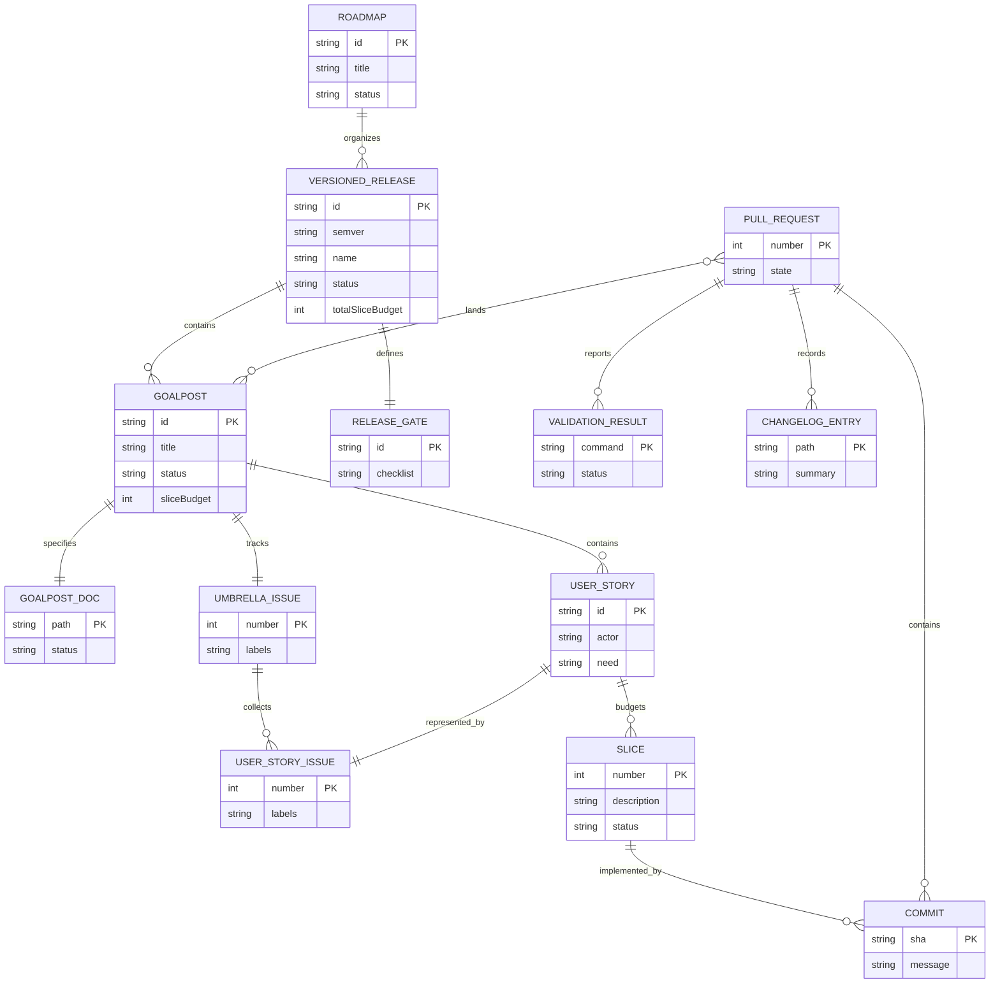

# Roadmap Planning System

## Purpose

jedit uses a roadmap-driven, issue-backed, goalpost-budgeted delivery system.

The system separates intent, coordination, execution, and proof:

- Markdown documents define intent, scope, product contracts, Echo authority
  boundaries, acceptance criteria, lower modes, accessibility, and validation.
- GitHub Issues coordinate goalposts, user stories, labels, and ownership.
- Branches, commits, and pull requests execute reviewable changes.
- Node tests, TUI model facts, JSON witnesses, generated artifacts, Echo
  release gates, quality gates, and runtime behavior prove implementation.

A design document may define intent, but it does not prove implementation. A
goalpost is complete only when the repo can prove the claimed behavior through
an executable or inspectable software surface.

## System Model

| Entity | Purpose | Location |
| --- | --- | --- |
| Roadmap | Orders a release path | Roadmap doc |
| Versioned Release | SemVer product target | Roadmap directory |
| Goalpost | Major milestone | Goalpost doc and umbrella issue |
| Umbrella Issue | Goalpost tracking root | GitHub issue with `goalpost` |
| User Story | User-centered behavior | Child issue and doc section |
| Slice | Reviewable increment | Goalpost checklist |
| Slice Budget | Planning estimate | Roadmap and goalpost docs |
| Acceptance Criteria | Completion contract | Docs and issue bodies |
| Validation Plan | Required proof commands | Design docs and PR bodies |
| Pull Request | Review and merge vehicle | GitHub PR |
| Changelog Entry | Release notes | `CHANGELOG.md` |

## Relationship Model

The relationship model is:



The same hierarchy in words is:

```text
Roadmap
  contains versioned releases

Versioned Release
  contains goalposts
  defines release completion gates

Goalpost
  has one design doc
  has one umbrella GitHub issue
  has one slice budget
  contains user stories
  contains a checklist of implementation slices

Umbrella Issue
  represents one goalpost
  collects child user-story issues as GitHub task-list items

User Story Issue
  belongs to one goalpost
  describes one behavior, workflow, or capability
  may be implemented by one or more slices

Slice
  is the smallest useful unit of progress
  should usually map to one test, witness, commit, or reviewable behavior change

Pull Request
  lands one coherent set of docs or implementation changes
  links back to the relevant issue, design doc, and goalpost
```

The canonical planning-to-merge path is:

```text
Roadmap doc
  -> versioned release section
    -> goalpost doc
      -> umbrella issue
        -> child user-story issues
          -> slices
            -> commits
              -> pull request
                -> merge
```

## Versioned Releases

A roadmap organizes goalposts into versioned releases. A versioned release is a
bounded product target with a SemVer release identifier, for example `v0.1.0`.

Release identifiers must use leading-`v` SemVer:

```text
vMAJOR.MINOR.PATCH
```

Versioned release planning has four jobs:

1. Name the release outcome in product terms.
2. Select the goalposts required to call that release complete.
3. Order goalposts by dependency and risk.
4. Define the release gate that must be true before the version can be called
   landed.

No versioned release roadmap is active. The `v0.1.0` roadmap was retired after
its authority claim was invalidated; current direction is the README's *Current posture*
and the [Jim.edict goalpost](https://github.com/flyingrobots/jedit/issues/295).
A new roadmap starts from this policy when a release is planned.

### Versioned Release Contract

```text
VersionedRelease = {
  id: "vMAJOR.MINOR.PATCH",
  name: string,
  roadmapDoc: MarkdownDocument,
  goalposts: Goalpost[],
  releaseGate: ChecklistItem[],
  totalSliceBudget: PositiveInteger,
  status: "planned" | "active" | "landed"
}
```

### Release Gate

A versioned release is ready when every goalpost in the release is landed and
the release-level gate is satisfied.

Each roadmap document states its release gate as a checklist of executable
conditions.

### Version Naming

Use SemVer roadmap names when a body of work has a release-level definition of
complete. Release IDs must include the leading `v` and all three SemVer
positions:

- `v0.3.0`: a feature or workflow release before the first complete version.
- `v0.3.1`: a patch release for fixes, docs, or proof hardening.
- `v1.0.0`: first version that can reasonably be called complete from a user's
  perspective.

Do not use shorthand release IDs such as `v1`, `v1.1`, or `v2` in roadmap
metadata, issue fields, release gates, or release-status reporting. Those forms
may appear only as informal prose when referring to a major release line.

Do not create a new version for every feature. Feature work belongs inside the
current active version unless it changes the release promise.

## Authority Model

Authority flows in this order:

1. Runtime product behavior: TUI model state, rendered output, text-session
   behavior, Echo-backed witnesses, save/export/recovery outcomes, and generated
   contract operation identity.
2. Node tests, release-gate scripts, quality gate output, JSON witnesses,
   generated artifacts, command output, and CI checks.
3. GitHub Issues and pull requests.
4. Design docs and roadmap docs.
5. `CHANGELOG.md`, the README's *Current posture*, and release notes.
6. Coordination memory.

Memory notes help coordination, but they do not override files, commits,
commands, GitHub Issues, pull requests, tests, generated output, or runtime
witnesses.

## Goalpost Contract

```text
Goalpost = {
  id: "JEDIT-V<major>.<minor>-GP<n>",
  title: string,
  umbrellaIssue: GitHubIssue,
  designDoc: MarkdownDocument,
  sliceBudget: PositiveInteger,
  userStories: UserStory[],
  checklist: Slice[],
  acceptanceCriteria: ChecklistItem[],
  validationPlan: CommandOrWitness[],
  completionState: "planned" | "active" | "landed"
}
```

A goalpost must answer:

- What user, maintainer, designer-engineer, or agent outcome does this
  milestone unlock?
- What inspectable contract exists?
- What is explicitly in scope?
- What is explicitly out of scope?
- Which stories make up the goalpost?
- How many slices are budgeted?
- What must be true before the goalpost is done?
- What tests, witnesses, generated artifacts, or facts prove it?
- What product or Echo-authority claim remains open after this lands?

## User Story Contract

```text
UserStory = {
  issue: GitHubIssue,
  actor: "user" | "agent" | "maintainer" | "designer-engineer",
  need: string,
  reason: string,
  proof: ChecklistItem[],
  sliceBudget: PositiveInteger
}
```

A well-formed story uses this shape:

```text
A <type of user> wants <capability/outcome> so that <reason>,
without having to <current workaround or failure mode>.
```

For jedit, agent stories must name model facts, JSON witness output, generated
artifacts, or deterministic commands that prove behavior without scraping
pixels or trusting prose.

A user story must name proof. Intent alone is not enough.

## Slice Contract

```text
Slice = {
  number: PositiveInteger,
  description: string,
  expectedProof:
    "test" |
    "witness" |
    "docUpdate" |
    "issueUpdate" |
    "runtimeBehavior" |
    "renderModelFact" |
    "echoReleaseGate" |
    "qualityGate",
  status: "open" | "inProgress" | "complete"
}
```

A slice is the smallest useful execution unit. A good slice can usually be
reviewed independently and has one obvious proof.

Slice budgets provide progress denominators:

```text
GoalProgress = completed slices / total slices
OverallProgress = landed goalposts / total goalposts
```

Progress reports should use concrete denominators, for example:

```text
Goal 3: [#####-----] 50% (slice 11 of 22)
Overall: [###-------] 30% (goal 3 of 10)
```

## Issue Label Model

Labels are query indexes, not prose decoration.

| Label | Meaning |
| --- | --- |
| `roadmap` | Participates in roadmap planning |
| `goalpost` | Umbrella milestone issue |
| `user-story` | Child issue scoped to a story |
| `work-in-progress` | Current active implementation cycle |
| `full-ci` | Force the full CI shard set on a PR |
| `enhancement` | Product or capability work |
| `bad-code` | Known technical debt or structural issue |
| `cool-ideas` | Deferred product or design idea |

The important invariant is that `goalpost` and `user-story` should not be mixed
casually. Umbrella issues get `goalpost`; child story issues get `user-story`.

## Workflow State Machines

### Goalpost Lifecycle

```mermaid
stateDiagram-v2
  [*] --> Planned
  Planned --> Scaffolded: design doc + umbrella issue + child issues
  Scaffolded --> Active: branch + implementation starts
  Active --> ReviewReady: slices complete + validation green
  ReviewReady --> Landed: PR merged
  ReviewReady --> Active: review issues found
  Active --> Retired: roadmap changes; its document is deleted
  Landed --> [*]
  Retired --> [*]
```



### Cycle Lifecycle

```text
sync merge target
  -> create branch
  -> write or update design and issue scaffold
  -> commit scaffold
  -> push branch
  -> open non-draft PR
  -> apply work-in-progress while active
  -> implement slices
  -> self-review
  -> fix review issues
  -> validate
  -> fill retrospective
  -> remove work-in-progress
  -> merge
```

## Proof Policy

No implementation goalpost is complete through documentation alone.

Acceptable proof includes:

- unit tests against runtime modules
- fixture-table tests
- TUI model and render facts
- JSON-reporting witnesses
- Echo release-gate reports
- generated Wesley contract artifacts
- schema validation
- deterministic command output
- CI checks
- accessibility and focus witnesses
- localization checks when strings change
- inspectable app facts

Docs can explain the contract. They cannot be the only evidence that the
contract works.

## Operating Invariants

- Every versioned release has a roadmap document.
- Every versioned release uses leading-`v` SemVer: `vMAJOR.MINOR.PATCH`.
- Every major milestone has a goalpost Markdown document.
- Every goalpost has one umbrella GitHub issue.
- Every umbrella issue collects child user-story issues as checklist items.
- Every child issue maps to a user story, not a vague task.
- Every goalpost has a slice budget.
- Every goalpost doc has a checklist.
- Runtime and product work must have executable proof.
- Markdown docs are planning artifacts, not proof artifacts.
- jedit owns editor nouns and product capabilities.
- Echo owns substrate truth, receipts, readings, scheduler authority, retained
  evidence, and recovery posture.
- Graft owns structural intelligence, not mutation authority.
- Bijou owns terminal runtime mechanics, not causal semantics.
- Changes are committed as normal commits, never amended.
- Branches, commits, and PRs do not use a `codex` prefix.
- Draft pull requests follow `docs/method/process.md`.

## Planning Document Roles

| Document | Time horizon | Primary question | Update frequency |
| --- | --- | --- | --- |
| `README.md` *Where Jim is going* | Long-term | Where are we going? | Rare |
| `README.md` *Current posture* | Current state | Where are we now? | Frequent |
| Roadmap docs | Release cycle | What must land for this version? | Per release |
| Goalpost docs | Milestone | What will this goalpost prove? | Per goalpost |
| GitHub issues | Execution | What work remains? | Continuous |

*Current posture* stays factual; it is not a manifesto, backlog, or issue
tracker. When a roadmap or goalpost is finished or abandoned, its document
is deleted as [documentation-lifecycle.md](documentation-lifecycle.md) requires.
