# Drawers And Panels

Drawers and panels are secondary Jim surfaces that appear over or beside the
editor without becoming independent applications. They should preserve context,
use theme tokens, and close predictably.

## Common Rules

All drawers and panels should:

- have one clear focused row or focused control;
- keep keyboard instructions in the footer or a compact hint row;
- wrap prose at word boundaries;
- clip paths and machine identifiers only when wrapping is impossible;
- avoid hardcoded foreground or background colors;
- leave the editor buffer unchanged unless the user runs an explicit command.

When a panel is meant for reading, it should stay visible until focus changes,
`Esc` closes it, or a related command replaces it. Time-limited toasts are not
enough for detailed explanations.

## Files Drawer

Open the files drawer with `Ctrl+B`. It starts in navigation mode. The sticky
search field has a distinct background, but takes keyboard input only after `/`
or a click on the field. Its caret appears while editing.

| Navigation key | Action |
| --- | --- |
| `j` / `k`, `Up` / `Down` | Select a displayed result and preview a file. |
| `/` | Edit the filter. |
| `Enter` / `l` | Open the selected file for editing, or enter a directory. |
| `Backspace` / `h`, `Alt+Up` | Enter the parent directory. |
| `r` / `Ctrl+R` | Refresh the current directory. |
| `Ctrl+B` / `Esc` | Close the drawer. |
| `Tab` | Cycle visible panes. |

| Filter key | Action |
| --- | --- |
| Printable characters | Fuzzy-filter loaded entries as you type. |
| `Left` / `Right`, `Home` / `End` | Move the query caret. |
| `Backspace` / `Delete` | Edit the query. |
| `Ctrl+U` | Clear the query. |
| `Esc` / `Enter` | Return to navigation and retain the query. |
| `Up` / `Down` | Select a displayed result. |
| `Ctrl+B` | Close the drawer. |

Matching is case-insensitive and accepts characters in order, so `rnt` can match
`render-tree.ts`. It preserves the directory's existing order. Matched filename
characters use accent color and bold weight; the selected row keeps a readable
foreground against its accent background. Empty results cannot open a hidden
file. Closing and reopening preserves the session query and starts in navigation.
Entering another directory clears it; refreshing preserves it. A restart starts
with an empty query.

Mouse motion highlights the row under the cursor without selecting it or reading
a preview. Hover and selection have distinct backgrounds. A click selects the
row and leaves focus in Files. Selecting a file, by keyboard, click, wheel, or
filter change, shows a labelled read-only preview in the main viewer. Enter opens
it through the native Echo text-import path and focuses the editor. A directory
click selects it; Enter enters it.

Previewing preserves the active buffer, including unsaved edits. Existing buffer
projections supply their current text; other files are read at most 64 KiB and
200 lines. Binary, unavailable, loading, and truncated previews are labelled.
Late results cannot replace the current selection's preview. Closing or leaving
Files restores the existing editor. Previews create no Echo buffers and have no
save action or persistent cache. The projection boundary is recorded in
[component ownership](../../jim-component-ownership.md).

Search covers currently loaded directory entries. Workspace-wide discovery,
semantic retrieval, and Graft symbols are deferred to
[issue #341](https://github.com/flyingrobots/jedit/issues/341). No SQLite database
or persistent index is created.

## Graft Drawer

Open the Graft drawer with `ctrl+g` when structural data is available.

The Graft drawer is a projection surface. It can show symbols, structure, and
projection posture, but it does not own source text. If the projection is stale
or unavailable, the drawer should say so directly.

When Graft supplies provider-neutral projection lanes (for example an Edict Core
projection, Echo Target IR, or an opaque obstruction receipt), the drawer shows
each lane and any bounded review payload for display only. Jedit never executes
Echo, computes digests, or admits artifacts on the strength of a lane; payloads
that exceed the adapter bounds are shown as omitted rather than truncated
silently.

## Causal History

Jim does not currently expose a history drawer. The previous drawer projected
process-local entries and was deleted. A replacement must consume a bounded,
basis-pinned Echo observation and must not imply that browsing history moved a
canonical head.

## Diagnostics Panel

Diagnostics can be opened from settings when Graft diagnostics are available.
The panel should appear beside settings when space allows. If terminal width is
tight, the layout may choose a stacked or clipped fallback, but it should not
silently replace the settings drawer without a clear focus transition.

## Inline Why Panel

`:why` and range why explanations are durable reading surfaces. They should be
anchored near the line or command they explain when possible. They should stay
visible until the cursor moves away, the user presses `Esc`, or another command
replaces the explanation.

## Implementation Map

| File | Responsibility |
| --- | --- |
| [`src/app/workspace/viewer-overlays.ts`](../../../src/app/workspace/viewer-overlays.ts) | Overlay composition. |
| [`src/ui/drawer-layout.ts`](../../../src/ui/drawer-layout.ts) | Drawer geometry helpers. |
| [`src/ui/graft-drawer.ts`](../../../src/ui/graft-drawer.ts) | Graft drawer rendering. |
| [`src/ui/graft-diagnostics-panel.ts`](../../../src/ui/graft-diagnostics-panel.ts) | Diagnostics panel rendering. |
| [`src/ui/why-inline-panel.ts`](../../../src/ui/why-inline-panel.ts) | Inline why explanation rendering. |
| [`src/app/workspace/file-explorer-preview.ts`](../../../src/app/workspace/file-explorer-preview.ts) | Selected-file preview lifecycle and stale-result protection. |
| [`src/adapters/file-preview.ts`](../../../src/adapters/file-preview.ts) | Bounded filesystem preview reads. |
| [`src/app/workspace/file-tree.ts`](../../../src/app/workspace/file-tree.ts) | File tree state and entry behavior. |
